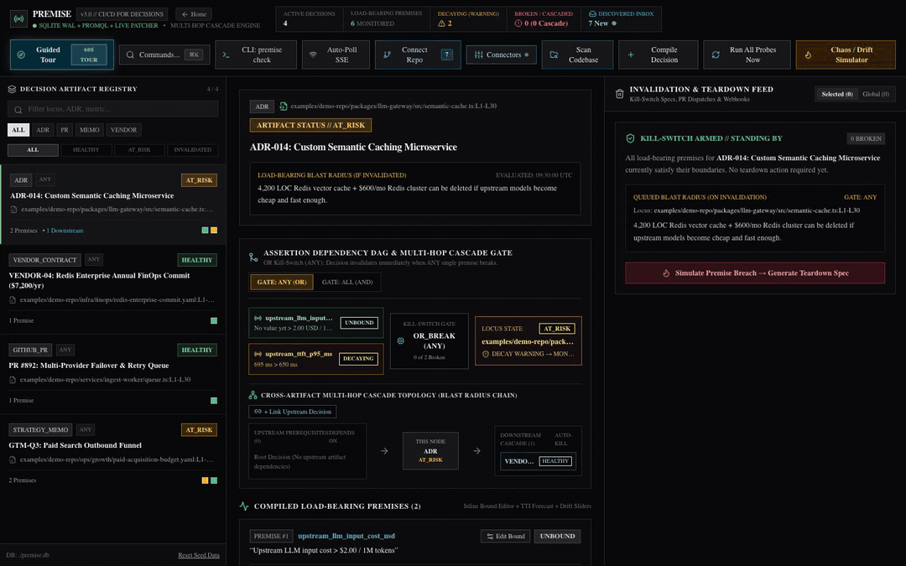

# Premise

Todo-or-die for assumptions: write down the numbers a decision depends on, check them against real data, and fail CI when one breaks.



## Why

Decisions like ADRs, vendor contracts and "we self-host because it is cheaper" rest on numbers that quietly change: a price drops, latency improves, usage shrinks. The document stays the same while the reason behind it is gone. This tool watches those numbers, tells you when a decision has lost its reason, and drafts what to tear down.

Try the live demo: https://premise-ops.com/demo

## Quickstart

You need [Bun](https://bun.com/docs/installation) and [Node.js](https://nodejs.org/en/download) 22 or newer (Next.js runs on Node, and the local database uses Node's built-in SQLite).

```bash
git clone https://github.com/e-skora/premise
cd premise && bun install
bun run dev
```

Then open http://localhost:3000/demo. The first run creates `premise.db` in the folder and fills it with demo decisions.

## Writing a premise

A premise is one number a decision depends on, a comparison, and a threshold. You can write premises in two places.

### In an ADR

Put Markdown ADRs in `docs/adr/`, `docs/decisions/` or `decisions/`. Each premise is a line of the form `variable_name <op> number unit`. Shortened from [`examples/demo-repo/docs/adr/ADR-005-pinecone-vector-index.md`](examples/demo-repo/docs/adr/ADR-005-pinecone-vector-index.md):

```markdown
# ADR-005: Managed Pinecone Vector Index for Customer Embeddings
**Status:** Accepted | **Owner:** Core Search Team | **Locus:** `examples/demo-repo/packages/search-engine/src/pgvector-index.ts:L1-L30`

## Load-Bearing Premises
We justify maintaining a dedicated paid Pinecone index reservation only while the following quantitative constraints hold:
1. **Vector DB Cost Ceiling:** vector_embedding_cost_monthly_usd < 450.00 USD / mo across all index pods.
2. **Index Query P95 Latency:** vector_query_p95_ms < 120 ms under 90th-percentile query load.

## Blast Radius & Sunset Criteria
Decommission $450/mo Pinecone pod reservation and revert to local Postgres pgvector if monthly cost breaches $450/mo or latency exceeds 120ms.
```

- The first `# ` heading is the title.
- `**Locus:**` names the code the decision protects, as `path:Lstart-Lend`.
- A `## Blast Radius` (or `## Sunset`) section says what to remove when a premise breaks.
- `bun ./bin/premise-cli.ts scan --repo` finds these files.
- You can also paste an ADR into "Compile Decision" in the web app, which also understands plain words like "under 450 USD per month" or "at least 60%".

### As a comment in code

Put a block of `@premise` comments in the first 40 lines of a file under `packages/`, `services/`, `infra/` or `ops/` (`.ts`, `.tsx`, `.js`, `.yaml`, `.yml`, `.tf`, `.py`, `.sql`). Lines can start with `//`, `#` or `*`. From [`examples/demo-repo/packages/search-engine/src/pgvector-index.ts`](examples/demo-repo/packages/search-engine/src/pgvector-index.ts):

```ts
// @premise title: ADR-027: In-Database pgvector HNSW Index (Skip Dedicated Pinecone Cluster)
// @premise type: ADR
// @premise claim: Total embedded document vectors remain below 1,500,000 rows so HNSW index fits in 16GB shared_buffers
// @premise metric: pgvector_total_rows < 1500000 rows (current: 1380000, margin: 0.12)
// @premise probe: SQL_METRIC | SELECT CAST(value AS REAL) AS value FROM TelemetryMetric WHERE variableName = 'pgvector_total_rows'
// @premise blastRadius: Migrate vector workload out of RDS Postgres into dedicated Pinecone/Qdrant cluster and remove HNSW maintenance cron
```

| Key | Meaning |
| --- | --- |
| `title` | Required. The decision's name. |
| `metric` | Required. `variable_name <op> number unit`, optionally followed by `(margin: 0.12)`. A `current:` value is ignored: a comment is not a measurement. |
| `type` | `ADR` (default), `GITHUB_PR`, `STRATEGY_MEMO` or `VENDOR_CONTRACT`. |
| `claim` | The premise in plain words. |
| `probe` | `PROBE_TYPE \| query or URL`: where the real value comes from. A probe written here is connected and runs on every check. |
| `jsonPath` | For JSON URLs, where the number sits, like `$.data.price` or `$.data[?(@.id=="x")].price`. Default: `$.metrics.<variable_name>`. |
| `blastRadius` | What to remove when the premise breaks. |

A file can instead point at a decision that already exists with `@premise-locus`, plus optional `Bound to:` and `Blast Radius:` lines. From [`examples/demo-repo/packages/llm-gateway/src/semantic-cache.ts`](examples/demo-repo/packages/llm-gateway/src/semantic-cache.ts):

```ts
// @premise-locus: art-adr-014
// Bound to: upstream_llm_input_cost_usd > 2.00 USD/1M AND upstream_ttft_p95_ms > 650 ms
// Blast Radius: 4,200 LOC Redis vector cache + $600/mo Redis cluster (redis-semantic-prod-01)
```

`bun ./bin/premise-cli.ts scan` finds these comments.

### Operators, margin and status

Operators: `<`, `<=`, `>`, `>=`, `==` (or `=`), `!=`.

A premise is **BROKEN** when its value fails the comparison, and **DECAYING** when it still passes but sits within the margin of the threshold (the margin is a fraction of the threshold, so `0.12` means 12%). Otherwise it is **VALID**. Until a probe or a person reports a value it is **UNBOUND** ("No value yet"), and a decision with no values at all shows **No data**, never HEALTHY. A decision is **INVALIDATED** when any premise breaks (or all of them, if you switch it to the `ALL` gate), and that spreads to the decisions that depend on it.

### Probe types

| Probe | Where the value comes from |
| --- | --- |
| `HTTP_JSON_PATH` | Fetches a JSON URL and reads one field. |
| `SQL_METRIC` | A read-only SQL query against Premise's own database. |
| `PROMQL` | A real Prometheus server when one is connected in the app; otherwise a PromQL subset (`avg_over_time`, `rate`, `quantile_over_time`, label selectors, arithmetic) over Premise's own stored samples. |
| `DATADOG_METRIC` | The Datadog Metric API, once Datadog is connected in the app. |
| `WEBHOOK_INGEST` | Whatever you `POST` to `/api/webhooks/metric`. |
| `WEB_SCRAPE_EXTRACT` | Accepted, but there is no scraper yet: it reads the last stored value. |

## CI

`bun ./bin/premise-cli.ts check` runs the probes and judges every premise. It exits `1` when a load-bearing premise is BROKEN, and also when a decision has no data, with the reason (no probe connected, or what the probe got back). `--expect-broken <ids>` passes only when exactly those premises are broken.

### In your own repo

Write your premises as `@premise` comments with a `probe` (and a `jsonPath` for JSON URLs), then add this as `.github/workflows/premise.yml`:

```yaml
name: Premise
on:
  push:
  pull_request:
  schedule:
    - cron: "0 * * * *" # numbers change even when your code does not
jobs:
  premise:
    runs-on: ubuntu-latest
    steps:
      - uses: actions/checkout@v7
      - uses: actions/checkout@v7
        with:
          repository: e-skora/premise
          path: .premise
      - uses: oven-sh/setup-bun@v2
        with:
          bun-version: latest
      - run: bun install --frozen-lockfile
        working-directory: .premise
      - env:
          PREMISE_DB_PATH: ${{ runner.temp }}/premise.db
        run: |
          bun .premise/bin/premise-cli.ts scan --import
          bun .premise/bin/premise-cli.ts check
```

It checks Premise out into `.premise/`, imports your comments into a fresh database (your decisions only, never the demo ones), runs every probe, and fails the build when a premise breaks or has no data. Use comments rather than ADR files here: an ADR line has no place to name a probe, so an imported ADR premise has no data until you connect a probe in the web app.

These exact steps were run by hand on a scratch repo with one `@premise` comment and a local price feed: a broken price exits `1`, a price that holds exits `0`, and a feed that is down or a comment with no probe exits `1` with "No data". This repo's own CI also runs the two commands on every push against a stand-in repo, [`examples/user-repo`](examples/user-repo). The two `actions/checkout` steps follow the [checkout docs](https://github.com/actions/checkout#checkout-multiple-repos-nested) but have not yet been run from another repo on GitHub.

### This repo

This repo checks itself with [`.github/workflows/premise-ci.yml`](.github/workflows/premise-ci.yml). CI has no live internet: ADR-014 reads a saved copy of the real OpenRouter price ($2.00 per 1M tokens), at which its "> $2.00" premise is really BROKEN, so the step runs `check --expect-broken upstream_llm_input_cost_usd` and passes only on exactly that result.

## Status: early stage

- No users yet. Built as an open-source tool and a portfolio piece.
- In the demo, one premise is live: ADR-014 reads the real Claude Sonnet 5.5 input price from OpenRouter. Every other value is demo data until you connect your own sources. The UI labels each value Live, Reported, Demo data or No value yet.
- PromQL without a connected Prometheus server is a subset that runs on Premise's own stored samples.
- GitHub PRs, Slack and PagerDuty are drafted as dry runs unless you set tokens. A dry run never shows a PR number or link.
- Language-model extraction in "Compile Decision" was tested with one real Anthropic call. OpenAI extraction has only been tested with a mocked response. Without a key, a basic parser is used and the app says so.
- Not on npm. You run it from a clone, or check it out next to your repo in CI.
- `WEB_SCRAPE_EXTRACT` has no scraper yet.

To host your own copy, see [`docs/DEPLOYMENT.md`](docs/DEPLOYMENT.md).

## License

MIT. See [`LICENSE`](LICENSE).
